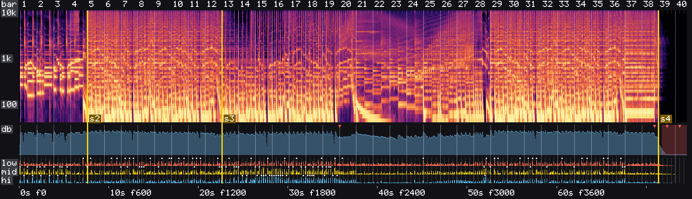
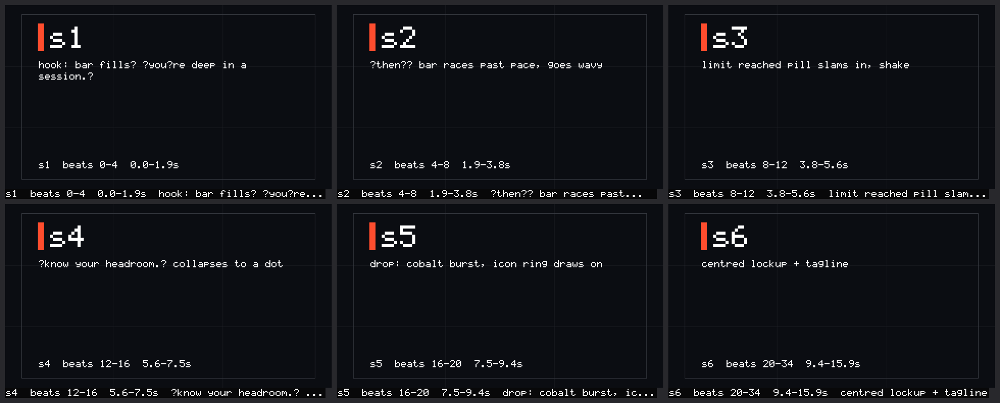
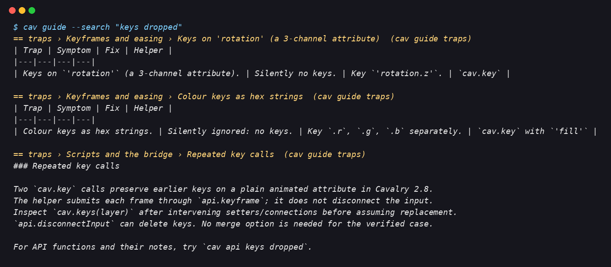

# Cav

`cav` builds motion graphics in [Cavalry](https://cavalry.studio) from a terminal.
A person or coding agent writes JavaScript files, and `cav` runs them in the open
Cavalry app. It makes contact sheets, checks common mistakes and renders video with
optional music.

| Part | What it is |
|---|---|
| `cav` | A command-line tool for macOS and Windows. It runs JavaScript in Cavalry, renders frames, contact sheets and MP4 videos, inspects scenes, finds the beats and the structure of a music track, draws it as a picture, checks a render against it, and searches the Cavalry API and docs offline. `cav guide` explains the workflow and has motion design recipes. |
| cav-bridge | A small Cavalry script that `cav` talks to. `cav setup` installs it. |
| `cavalry` skill | A short entry point for coding agents. It checks the setup and sends the agent to `cav guide`. Packaged as a Claude Code, Codex and Antigravity plugin. |

The CLI sends scene work to Cavalry on the desktop. Agents can call commands from a
shell and request guidance when needed. `cav mcp` has a separate role: it displays
the review page in supported chats. See [Review in the chat](docs/user-guide.md#review-in-the-chat).

## Requirements

- Cavalry 2.4 or newer. Tested on 2.7.2 and 2.8.0.
- macOS or Windows. See [What was tested](#what-was-tested) for the details on Windows.
- ffmpeg, for videos with audio and for beat detection (`brew install ffmpeg`, or
  `winget install Gyan.FFmpeg`).

## Install

**1. Install `cav`.** On macOS:

```bash
curl -fsSL https://raw.githubusercontent.com/rock3r/cav/main/install.sh | sh
```

On Windows, in PowerShell:

```powershell
irm https://raw.githubusercontent.com/rock3r/cav/main/install.ps1 | iex
```

The installer checks the download against release checksums and runs `cav setup`.

**2. Start the bridge.** In Cavalry, click **Scripts > cav-bridge** and keep its window
open. Repeat this after each Cavalry restart. Then check the setup:

```bash
cav doctor
```

**3. Optional: add the agent plugin.** In Claude Code:

```text
/plugin marketplace add rock3r/cav
/plugin install cavalry@cav
```

The optional `/plugin install cav-review@cav` plugin shows open review notes above the
Claude Code prompt. It can start a turn when the reviewer sends notes.

In Codex:

```bash
codex plugin marketplace add rock3r/cav
```

```bash
codex plugin add cavalry@cav
```

In the Antigravity CLI, from a clone of this repository:

```bash
agy plugin install ./plugins/cavalry
```

The plugin gives Antigravity the skill, `cav mcp` and a review hook. The Antigravity
CLI runs plugin hooks. The app and IDE load the skill and server without the hook. See
[the user guide](docs/user-guide.md#using-cav-with-a-coding-agent).

Other agents: copy `plugins/cavalry/skills/cavalry` into the agent's skills folder.

**Agents in a sandbox.** Some sandboxes block `127.0.0.1` or writes outside the project.
`cav doctor` then reports `blocked: a sandbox`. Allow access to `127.0.0.1:8723` or run
`cav relay` outside the sandbox. The relay forwards commands through a folder. See
[Agents in a sandbox](docs/user-guide.md#agents-in-a-sandbox).

## Try it

```bash
cav scene new --width 1920 --height 1080 --fps 60 --seconds 4
cav guide            # how to build a scene, with a first script to copy
cav run title.js     # run your script inside Cavalry
cav sheet            # look at 12 frames in renders/sheet.png
cav check            # find problems a viewer would notice
cav render -o out/title.mp4
```

The [user guide](docs/user-guide.md) covers a first animation, music timing and
troubleshooting.

## What it looks like

`cav spectrogram` draws musical bars, sections and accents for visual inspection.



`cav board sheet` shows storyboard shots planned against beats.



`cav guide --search "keys dropped"` finds guidance for a reported symptom.



## Commands

| Command | What it does |
|---|---|
| `cav setup` / `cav doctor` | Install or check everything: token, bridge script, Cavalry, ffmpeg, docs, running bridge |
| `cav guide [topic]` | How to work: building a scene, the production flow (or a custom `flow.md`), design recipes, music sync, traps, native features, production, software showcase videos |
| `cav guide --search <words>` | The best guide sections for a symptom when its topic is unknown (offline) |
| `cav status` | Existing bridge state; no scene work is queued |
| `cav scene new\|comp\|open\|save` | New scene (refuses to discard unsaved work), change the comp, open, save |
| `cav run <file.js>... \| -e <code>` | Run JavaScript in Cavalry with the helper library loaded; prints the return value |
| `cav job wait [<id>]` | Wait for one raw job without continuing command phases |
| `cav operation status/resume <id>` | Inspect or continue a complete scene open, frame, sheet, render, check or run after a timeout |
| `cav tree` / `cav layer <id>` | The layer tree; one layer's position, bounding box and keys |
| `cav frame [n...]` / `cav sheet [frames]` | Render frames to PNG, or a labelled contact sheet |
| `cav onion [start-end]` | Draw several frames on top of each other to show a motion path and its easing |
| `cav check [--quick] [--profile]` | Structural performance warnings and bounded visual/measured checks |
| `cav render [-o out.mp4] [--audio track]` | Render to MP4, check the frame count, add the music |
| `cav beats <audio>` | Tempo, beats and downbeats as frame numbers, plus sections, rises, silences and accents |
| `cav spectrogram <audio>` | Draw the track: spectrogram, loudness, beats, sections and accents on one time axis |
| `cav sync <video.mp4>` | Measure the cuts and hits of a render against the beats |
| `cav review [video.mp4 \| brief.json \| moodboard.json \| storyboard.json]` | A review page: step frames or look at items, draw, comment, approve a stage of stills, then send the notes to the agent (`wait`, `export`, `resolve`) |
| `cav mcp` | An MCP server (stdio) that shows the review page (video or stills) inside the chat, as an MCP App |
| `cav brief init\|show` | Write and check `brief.json`, the brief agreed with the user; `cav board init` and `cav scene new` take size, fps and length from it |
| `cav plan` | Show each stage of the production flow (or a custom `flow.md`): done, waiting for approval, missing or unknown. It also names the next step. It only reads |
| `cav board init\|frames\|sheet\|animatic\|mood` | Storyboard timed in beats, frames per shot, a board image, an animatic on the music, mood boards |
| `cav gen image\|vector` | Generate stills, transparent PNGs and SVG; trace a PNG to SVG |
| `cav ref` / `cav sfx search\|get\|gen\|index` | Find reference images, sounds and music under free licences; generate sound effects |
| `cav music gen\|render` / `cav listen <track>` | Generate music planned on the storyboard, or render a written score locally; judge takes: loudness, cuts, picture, local scores, critique |
| `cav score [storyboard.json]` | A REAPER project with the render, a marker per shot and the takes, to finish the music by ear |
| `cav credits [check\|licence]` | Credit lines and licence checks for every asset the project uses |
| `cav config [check\|set-key\|order\|model]` | Which service does each job, where its key lives; `cav doctor --services` tests them |
| `cav api` / `cav docs` / `cav types` / `cav helpers` | Offline search: API, Cavalry docs, layer types, the helper library |
| `cav relay --spool <dir>` | Forward commands for agents whose sandbox blocks `cav` |
| `cav version [--check]` / `cav update` | Versions, and updates that ask before they install |

Production commands have paths without API keys: greybox frames, Openverse, Wikimedia,
written scores, local uv models, and user-run ComfyUI, ACE-Step and YuE2 servers.
Configured keys add other services. `cav guide production` explains the service order.

Every command accepts `--json`. Exit code 0 means success; 1 means error; 2 means the
bridge is unreachable; 3 means work remains pending; and 4 means bridge loss.

## Update

```bash
cav update
```

`cav update` shows the release and asks before installing. It checks the download and
runs `cav setup`. If `cav doctor` reports an older running bridge, restart its Cavalry
window. Update the Claude Code plugin with `/plugin marketplace update cav`.

## How well it works

An agent using GLM-5.3 Flash completed the same 11 motion briefs under three tool
conditions. Automatic checks and a blind judge compared the Cavalry 2.8.0 results:

| Agent used | Tasks passed | Mean time | Mean tokens |
|---|---|---|---|
| `cav` and the skill | 8 of 11 | 1,177 s | 1.22 M |
| `cav` only | 8 of 11 | 1,025 s | 0.98 M |
| the upstream cavalry-mcp server | 3 of 11 | 1,604 s | 3.22 M |

The CLI and CLI-plus-skill conditions each passed 8 of 11 tasks. The cavalry-mcp condition
passed 3 of 11 and used more tokens. This sample found no measured gain from the old
long skill. Version 1.0 moved its guidance into `cav guide`. See
[the evaluation](docs/evaluation.md) for methods, full results and limits.

## What was tested

| What | macOS | Windows |
|---|---|---|
| Install from the release, `cav setup`, offline commands | tested | tested (Windows 11, x64) |
| `cav update` from 1.0.0 to 1.0.1 | tested | tested |
| Driving Cavalry: jobs, sheets, checks, renders | tested (65 helper and 14 native-feature checks live) | not tested |
| Claude Code and Codex plugins, with a sandboxed agent through `cav relay` | tested | not tested |
| Antigravity plugin | `agy plugin validate` only | not tested |

## Documentation

- [User guide](docs/user-guide.md): install, the first animation, music, agents, troubleshooting.
- [Architecture](docs/architecture.md): how the parts fit together, for people who change the code.
- [Evaluation](docs/evaluation.md): Explains the measurement methods and reports the results.
- [Changelog](CHANGELOG.md) and [releasing](RELEASING.md).

## Recovery, diagnostics and signed macOS bundles

`scene open`, `frame`, `sheet`, `render`, `check` and `run` return operation IDs. After
a timeout, inspect `cav operation status <id>` and continue with
`cav operation resume <id> --timeout 90m`. Do not submit the original command again.
`cav check --quick --json` avoids playhead changes, bounds and rendering. `--profile`
measures a small frame set. Quick checks follow referenced pre-comps without switching
the active comp and include comp paths in findings. Select later frames with
`--profile-frames 840,1560,1908`. Simulations need chronological PNG warm-up. Allow
extra frames with `--max-warmup 2000` and enough time. Reports identify failures and
skipped work. A profile that reaches its budget between samples records skipped
coverage, even if no sample finishes. It does not report an API failure for that case.
See [operation recovery](docs/recovery.md) for states, concurrency and remaining limits.

macOS releases keep a signed, notarized and stapled `Cav.app`. The installer adds its
executable to PATH through a symlink. Users with an older shipped updater need the
current installer once to migrate. Development builds need no credentials. Release
builds require signing. See [notarization](docs/NOTARIZATION.md).

## Development

```bash
go test ./...
node --test assets/helpers/test/*.test.js assets/bridge/test/*.test.js
cav scene new --force --width 1280 --height 720 --fps 30 --seconds 3   # a throwaway scene
cav run assets/helpers/test/live.js                                    # live checks in Cavalry
claude plugin validate . --strict
```

## Credits

- [cavalry-mcp](https://github.com/m18h/cavalry-mcp) by Michael Essandoh (MIT): This project
  derives its bridge script from that bridge. The token handshake, API reference and docs
  search also follow its ideas. See `NOTICE`.
- [cavalry-types](https://github.com/scenery-io/cavalry-types) by Remco Janssen (MIT): API names
  and signatures.
- Cavalry is made by Scene Group (now part of Canva). Cav is a community plugin and is not affiliated with Cavalry, Scene Group, or Canva.
  The Cavalry docs are not included; `cav docs update` downloads them to the local computer.

Licence: MIT.
