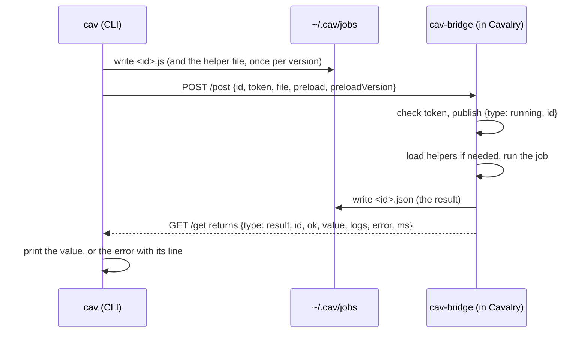
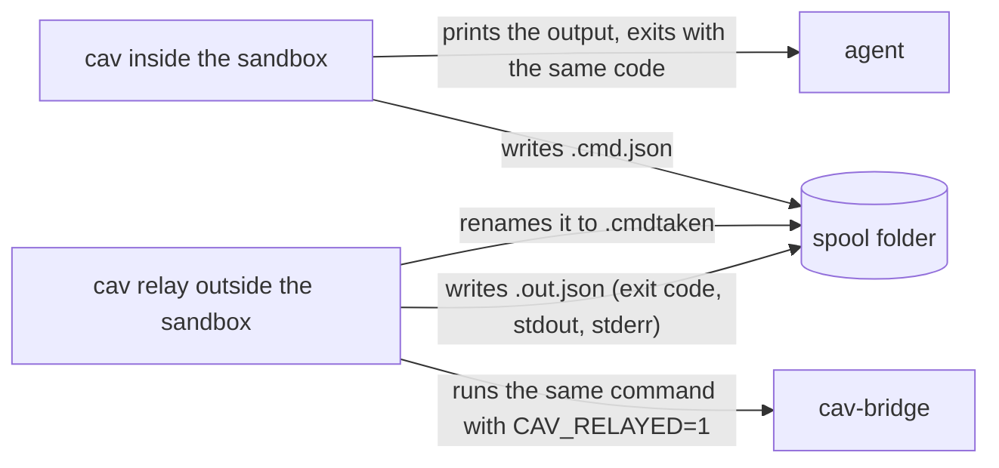

# cav architecture

This document explains the CLI, Cavalry bridge, helper library and agent skill. It
also traces a request through them for code contributors.

Status: Native work ran on macOS with Cavalry 2.7.2 and 2.8.0. The Windows native code
paths were written; testing remains pending. Updated 2026-10-01.

## Summary

An agent or person calls `cav` from a shell. The CLI sends JavaScript to a bridge script
inside the running Cavalry app. The bridge runs it and returns a result. Scene renders,
contact sheets and checks use this path. Beat grids and offline search run in the CLI.

The project uses a CLI for Cavalry scene work and a short agent skill for setup.
Cavalry requires an open desktop session with shell access. Agents can read `cav guide`
when they need workflow instructions. `cav check` reports scene findings, and command
errors distinguish pending work from failure. The skill points agents to these CLI
guides. In the clean evaluation, the CLI alone matched the CLI with the older long
skill, so version 1.0 moved the detailed guidance into the CLI.

`cav mcp` serves the `cav review` page as an MCP App through `internal/reviewmcp`.
It does not submit scene work to Cavalry. The chat displays the page in a frame without
network access. `assets/review/mcp-app.js` routes page requests through the host to
the app-only `review_request` tool. That tool uses the `cav review` handler and returns
JSON as text plus video and snapshots as `data:` URLs. It can reach only videos the
agent opened with `show_review`.

Current limits:

- The bridge runs on Cavalry's single JavaScript thread. One slow script blocks every
  other scene request. Status now reads existing state without queuing scene work.
  Its HTTP read can still time out while a native call blocks the UI thread.
- Starting or restarting the bridge needs the Cavalry GUI (Scripts menu).
- Windows is untested.

## Components

| Part | Where | Language | What it does |
|---|---|---|---|
| `cav` CLI | `cmd/cav`, `internal/*` | Go, standard library only | Every user-facing command. Talks to the bridge over HTTP, or through a spool folder when sandboxed. |
| cav-bridge | `assets/bridge/cav-bridge.js` | Cavalry JavaScript (UI script) | Listens on `127.0.0.1:8723`, runs jobs, publishes their state and result. |
| Helper library | `assets/helpers/cav-helpers.js` | Cavalry JavaScript | The global `cav` inside jobs: creation, keys, easing, motion recipes, native features. |
| API reference | `assets/apiref/*.json`, `tools/build_apiref.py`, `tools/api-notes.json` | JSON | Offline data for `cav api` and `cav types`. |
| Guides | `assets/guide/*.md` | Markdown | What `cav guide` prints: scene building, production flow, design recipes, music sync, traps, native features, production, software showcase videos. `internal/guide` splits them by heading and table row for `cav guide --search`; `<!-- aliases: … -->` comments add search words and are not printed. |
| Skill | `plugins/cavalry/skills/cavalry` | Markdown | A short entry point: when to use `cav`, setup checks, and a pointer to `cav guide`. |
| Plugin packaging | `plugins/cavalry/*plugin.json`, `.claude-plugin/`, `.agents/plugins/` | JSON | Claude Code, Agent Plugins and Codex manifests and marketplace entries. |
| Installers | `install.sh`, `install.ps1` | shell, PowerShell | Download a release, verify its checksum, run `cav setup`. |

The Go binary embeds the bridge script, helpers, guides and API reference through
`assets/assets.go`. macOS distribution requires the full signed Cav.app, whose
executable contains those resources. Linux and Windows use bare binaries.

The evaluation harness is in `tools/evals/`. It writes run data, fixtures, frozen
snapshots and scratch scenes to uncommitted `.plans/evals/`. The README summarizes
its method and results.

## Files on disk

| Path | Written by | Contents |
|---|---|---|
| `flow.md` (project folder) | the user | Replaces the standard production flow. Read by `cav guide flow` through `internal/flow`. Never written by cav. |
| `~/.cav/flow.md` | the user | The same, for every project without its own `flow.md`. The standard flow (`assets/flow/standard.md`) is the last choice. |
| `~/.cav/token` | `cav setup` | 64 hex characters, mode 0600. Every request must carry it. |
| `~/.cav/jobs/<id>.js` | `cav` | The job script. Deleted after the job finishes. |
| `~/.cav/jobs/<id>.json` | bridge | The job result. Kept for a day, so `cav job wait <id>` works after the fact. |
| `~/.cav/jobs/cav-helpers-<version>.js` | `cav` | The helper library the bridge preloads. |
| `~/.cav/operations/<id>.json` | cav | Durable command phases, jobs, output and partial checkpoints; private, retained. |
| `~/.cav/operations/profile-<id>/` | cav/bridge | Cumulative measured samples and optional PNGs. |
| `~/.cav/last-job` | `cav` | Id of the most recent job, for `cav job wait` without an id. |
| `~/.cav/cache/docs/` | `cav docs update` | Downloaded Cavalry docs pages and the search index. |
| `~/.cav/services.json` | `cav config` | Service order per job, key sources (never key values), models, endpoints; mode 0600. |
| `~/.cav/oauth/<service>.json` | `cav config login` | OAuth access and refresh tokens; mode 0600. The client secret stays in its own key source. |
| `~/.cav/sound-libraries.json` | `cav sfx index` | Local sound folders and their licence. |
| `~/.cav/cache/review/<sha256>.mp4` | `cav review` | The all-intra proxy of a render, one per content hash. |
| `.cav/project.json`, `.cav/manifest.json` | `cav credits`, `sfx`, `ref`, `gen`, `board`, `music` | Per project: the accepted licence, and every imported or generated asset with its licence, credit and origin. |
| `<video>.review.json`, `review/<video>/*.png`, `.<video>.review.json.lock` | `cav review` | Review notes, sends, and one snapshot per note. Every change to the review file holds the lock file, so the CLI and the chat's server processes do not save over each other. |
| `<name>.review.json`, `review/<name>/*.png` next to `brief.json`, `moodboard.json` or `storyboard.json` | `cav review` | The same for a review of stills. It also holds `kind`, the stage `approved` (with the hash of every item) and `approvalCleared` (why an approval was removed). |
| `<Cavalry Scripts>/cav-bridge.js` | `cav setup` | The bridge script. macOS: `~/Library/Application Support/Cavalry/Scripts`. Windows: `%APPDATA%\Cavalry\Scripts`. |

`CAV_HOME` changes the `~/.cav` location. `CAV_SCRIPTS_DIR`, `CAV_BRIDGE_HOST` and
`CAV_BRIDGE_PORT` override their respective defaults.

## How a job runs

A job is JavaScript that runs in Cavalry. `cav run`, `cav scene`, `cav tree`, `cav frame`,
`cav sheet`, `cav check` and `cav render` submit jobs through the same bridge path.

The client accepts the first available result from the file or GET response. GET holds
only the latest job, so another client can replace that response.

### Job states and exit codes

`cav` reports long jobs by their current state. The exit codes distinguish these cases:

| Situation | What the client sees | Exit code |
|---|---|---|
| The job finished | result with `ok: true` | 0 |
| The script threw | result with `ok: false`, message, line | 1 |
| Nobody listens on the port | connection refused | 2 |
| Cavalry accepts the connection and fails to answer within 30 s | "listening but not answering" | 2 |
| The wait budget expires without a result | operation/job id and pending/unknown native outcome | 3 |
| A job wait sees connection refusal or an operation sees a changed session | bridge lost, unknown native outcome and retained artifacts | 4 |
| A raw job wait sees no answer for 120 s | "bridge lost", unknown native outcome | 4 |
| `cav job wait` on an id that is not queued, running or stored | "unknown job" after 5 s | 1 |

After 10 s without a response, `cav` prints "Cavalry is busy (not answering)" and
continues waiting. A native call that holds Cavalry's main thread blocks HTTP responses.
Deleting hundreds of layers can do this.

### Inside the bridge

The bridge runs as one Cavalry UI script under `Scripts > cav-bridge`. It uses
`api.WebServer`, whose callback polls about once per second. An `api.Timer` checks for
requests every 50 ms. A small job took about 60 ms end to end on an M-series Mac.

For each request the bridge:

1. checks the token;
2. publishes `{type: "running", id}` on GET;
3. installs its per-job environment: console capture, the `api` error wrapper, the `cav`
   helpers, and, for `--restricted` jobs, stubs for `api.runProcess` and
   `api.runDetachedProcess`;
4. runs the code as `(0, eval)('(function() {' + code + '})')()`, so `return` works and the
   code runs in global scope;
5. removes the per-job environment, writes the result file and publishes the result.

Cavalry native errors have no stack. The bridge wraps them in JavaScript errors with
the call and arguments, allowing the CLI to report the script line.

### Isolation from other scripts

Since 0.4.0, the bridge keeps its state inside one function. When idle, it leaves no
global `api` wrapper or `cav` helpers. Those exist only during a cav job.
`assets/bridge/test/isolation.test.js` loads the bridge in a sandboxed context and fails if it
defines a global name, leaves `api` changed after a job, or lets job code read its token.

The isolation check is precautionary. Evaluation first attributed mixed bridge results
to shared UI-script globals. A port forwarder started by an evaluation agent caused
them instead. See [evaluation.md](evaluation.md). On Cavalry 2.8.0, a cav job could
not read the cavalry-mcp bridge's top-level names. UI scripts had separate global
scopes in that check. Cavalry 2.7.2 was not checked.

The two bridges must use different tokens. Each accepts a request carrying its own
token regardless of the request's original port.

Job code runs in the bridge's global scope. Values saved on `globalThis` persist until
the bridge restarts. Scripts use this to pass IDs between runs.

## The helper library

`cav-helpers.js` defines global `cav` inside one function. The CLI embeds the file and
sends it as a job `preload`. The bridge evaluates it once per session and again when its
version changes. That version combines the file's semantic version with the first 10
hex digits of its SHA-256. An edit therefore reloads the helpers.

`cav helpers` builds its reference from `//@` lines. Keep each line beside the code
it describes.

The helpers handle these Cavalry 2.7.2 failures. `cav guide traps` has the full list:

- New layers are created with the selection cleared, because `api.create` nests a new layer
  next to the current selection.
- `+y` is up and `(0, 0)` is the comp centre.
- Colour keys use separate `.r/.g/.b` channels, because hex strings on colour keys are ignored.
- Rotation keys go on `rotation.z`; keys on `rotation` are dropped.
- A single number for a two-value attribute is expanded to both values; Cavalry would set
  `(0, 0)`.
- Reading a value at another frame (`valueAt`) avoids moving the playhead when it can. A
  playhead move re-evaluates the whole scene. If the attribute has no keys, cav reads the
  value directly. It also reads directly before the first key and after the last key,
  using the keyframe node in the latter case.

## Flows

### Long jobs and `cav job wait`

`cav run --timeout 10m` waits ten minutes at most, then returns code 3 and a job ID.
The native call can continue in Cavalry. Timeout does not establish whether it finished.
`cav operation resume <id>` continues a tracked command. `cav job wait <id>` waits for
one job and can read completed results retained for one day.

### Sandboxed agents: spool and relay

Some agent sandboxes block `127.0.0.1` and writes outside the work folder. Spool mode
supports these agents.

`CAV_SPOOL` enables spool mode. A `.cav-spool` file in the current folder or a parent
also enables it. The file contains a path relative to itself or an absolute path.

In spool mode, cav forwards full command lines. Commands that read files or run ffmpeg,
such as `cav render` and `cav beats`, can therefore use the relay. It runs each command
from the agent's working folder.

- Some commands never go through the relay because they need nothing from outside:
  `help`, `version`, `helpers`, `guide`, `api`, `types`, `relay`.
- The relay refuses `setup`, `update` and `relay`.
- Each request runs on its own goroutine, so one slow command (a long `cav job wait`)
  cannot hold up the others. Requests are renamed before they run, so two workers never
  take the same one.
- `--restricted` stubs out the process-launching APIs during relayed jobs. This prevents
  accidental process launches. Any job can still use every scripting API, including file
  access, so `--restricted` cannot defend against attacks.

The evaluation harness uses spool mode for agents in Pioneer's sandbox.

### Rendering a video

`cav render` creates a render-queue item named `cav render` on first use. It assigns
the `renderMP4` generator, output path and frame range. After rendering, ffprobe counts
video packets and warns if the count differs from the requested range. With `--audio`,
ffmpeg copies video and adds AAC audio at 192 kb/s, trimmed to video length.

New render-queue items can inherit another project's output folder. `cav render` sets
the path explicitly.

### Contact sheets and frames

`cav frame` renders PNGs through the shared job path. `cav sheet` renders frames at
reduced scale and arranges them in one PNG through `internal/sheet`. Labels below each
tile give frame, time and optional `--bpm` beat number. A built-in bitmap font removes
the need for external font files.

`cav onion` renders 2 to 24 frames and blends them into one image (`internal/sheet/onion.go`).
For each pixel, the "still" picture uses the first frame's colour when the first and last
frames agree. Otherwise it uses the flat background colour if any frame shows it there.
If neither condition applies, it uses the median frame. This keeps an object that eases in and then holds
for most frames counted as moving. Pixels that differ from the still picture are drawn per
frame, oldest first, fainter and tinted blue to orange; the last frame is drawn solid,
untinted and outlined in white. It also reports, for each pair of neighbouring frames, the
share of pixels that changed by more than 24 of 255 in any channel, and the box around them.

Forge Dynamics and particles require frames rendered in order. Use a step-1 range such
as `0-59:1` to preview their simulation.

### `cav check`

`cav check` starts with the limited structural pass in `assets/diagnostics/structure.js`.
It reads metadata/connections, warns on per-copy JavaScript (including duplicated source
layers), nested Duplicators, fan-out and simulations, and provides supported static copy
estimates. It makes no frame changes, bounding-box calls or renders. `--quick` stops there.

Default visual checks limit layers, animated attributes, keys and frame evaluations.
Reports list inspection errors and skipped checks. A `finally` block restores the
playhead. Simulations skip checks that jump between frames. This pass does not measure
blank starts or ends. Older visual rules were tuned on saved evaluation scenes; that
evidence does not validate this sampling policy.

Optional profiling measures a small frame set in one chronological job. Simulations
use consecutive initial frames. The job writes progress between native calls and
measures setFrame and optional PNG API calls separately. It restores the playhead after
normal or recoverable completion. The first sample's cache state is unknown, and no
layer changes for attribution. See [diagnostic semantics](recovery.md).

### Beats

`cav beats` decodes audio with ffmpeg. `internal/beats` uses spectral flux and low-band
energy to estimate tempo, beats and downbeats. Autocorrelation uses a prior near 120 BPM
and checks half and double tempo. Dynamic programming tracks beats before the command
fits a steady grid. Low-band energy identifies downbeats. Output gives each beat's time
and frame at `--fps`.

Tempo detection can choose half or twice the actual tempo. `--bpm` limits the search
to ±8 % of a known value.

With audio, `internal/beats/profile.go` also describes musical changes. Its second
short-time Fourier transform uses a 2048-sample window and 256-sample hop at 22 050 Hz.
It produces 96 log-spaced bands from 40 Hz to 11 kHz, RMS loudness and three coarse
bands: below 150 Hz, 150 Hz to 2 kHz and above 2 kHz. Each coarse band has its own
scaled onset curve, so high-frequency hats do not dominate kicks and stabs.

- Sections: one feature vector per beat (loudness, the three bands and 8 spectral bands,
  each scaled to unit spread). Novelty after Foote (2000) compares the 8 beats before each
  beat with the 8 after. Peaks above the mean plus 0.75 standard deviations become
  boundaries, moved onto a downbeat within one beat, at least 8 beats apart.
- Events: a silence is 0.15 s or more at 35 dB below the loud parts of the track. A rise or
  fall is a beat at least 6 dB louder or quieter than the two beats before it; runs within
  2.5 beats are merged. Loudness over a stretch is averaged as power, and only analysis
  windows that lie wholly inside the stretch count, so a hit does not leak into the beat
  before it.
- Accents: the strongest onset peaks, at least 100 ms apart, at most 1.5 per second.

The launch track check used the layout in `launch-video/plan.md`. It found the drop at
4 s and stabs at 46 s. It also found a one-beat pause at 51.5 s, a hit at 52 s,
and the final chord at 56 s. Section boundaries were less exact. The 52 s hit was not a boundary.

`cav spectrogram` draws this profile in `internal/beats/picture.go`. `cav sync` decodes
video to 160x90 greyscale frames and measures mean frame changes in
`internal/beats/video.go`. A cut changes four times more than nearby frames. A peak
marks the fastest frame of a move above surrounding slower frames and the prior three.
A stop drops from full speed to near rest. cav compares each hit to the nearest detected
beat or midpoint. This follows drifting tempo. A difference within about 35 ms counts
as on the grid.

### Production commands

`config`, `review`, `plan`, `board`, `gen`, `sfx`, `ref`, `credits`, `listen`, `music` and
`score` run without the bridge. Their Go code uses ffmpeg, HTTPS and uv:

- `internal/services` stores the service catalog, order per job and key resolution
  (environment, macOS keychain or Windows Credential Manager, `op read`, OAuth) and one free health call per service.
  `services.Pick` returns the first service in the job's order that is usable now, without a
  network call, and lists the ones it skipped and why.
- `internal/review` serves one embedded HTML page without dependencies. Its all-intra
  proxy lets a seek decode one frame. `requestVideoFrameCallback` identifies the displayed
  frame. The page draws marks into a canvas copy and sends that image as the note snapshot.
  Each change rereads and atomically writes `review.json`, allowing both server edits and
  `cav review resolve`. The server accepts only `127.0.0.1`/`localhost` hosts and
  same-origin JSON writes.
  `internal/brief` owns `brief.json`: the fields and their order, plain-English checks
  (problems, missing required fields, notes) and the text of each field. `cav brief`,
  `cav board init`, `cav scene new` and the review loader all read the file through it. The
  hash of a brief item stays the hash of the field's own JSON, so a verdict from before the
  package still holds; the words never go into the hash.
  The same server reviews stills (`Server.Stills`, `items.go`, `stills.go`). `KindOf` reads
  the target's `schema` (or its file name) and `Items` loads the items of a brief, mood
  board or storyboard. Each item has a sha256 over its own content, such as a shot's JSON
  and the bytes of its frame. A note and a verdict keep the hash of the item they were
  given on. `Reconcile` removes stage approval when an item changes, is added or removed,
  or becomes blocked. The server runs it before every read and write; it needs no background
  loop. The server serves an item image only if it is a regular file inside the target folder,
  with no link. It applies the same checks to mood board clips at `/api/item/{id}/clip`.
  The video routes answer 404. The
  approval is written by the page's `POST /api/approve` and by nothing else.
- `cav plan` reads the active flow through `internal/flow` and checks each stage. `flow.Check`
  looks for an output in the project folder: a file, a folder that holds a file, or a `*`
  pattern, without the review files. `review.ReadStatus` reads a review file in memory,
  as `cav review export` does. It runs `Reconcile` on the loaded copy without saving it.
  A plan therefore never removes an approval from the file and takes no lock. Only
  `cav review` and the review page write review files.
- `internal/reviewmcp` implements `cav mcp` with the official Go MCP SDK. It serves the same
  page with `assets/review/mcp-app.js` added, and answers the page's requests in-process
  through the `internal/review` handler. It makes its own smaller proxy (640 pixels wide,
  in `~/.cav/cache/review-preview`), because the chat receives the whole file inline.
- `internal/sources` and `internal/library` search media libraries, download files and keep the
  manifest; licence terms are normalised to SPDX-like ids with commercial, share-alike and
  no-derivatives flags.
- `internal/imagegen`, `internal/music` and `internal/listen` call the
  image, music and audio-model APIs. Their tests check request shapes against the vendor
  documentation. Live services have not been checked.
- `internal/pyrun` runs the embedded Python helpers (`assets/python`) with
  `uv run --no-project --with ...`. Each helper gets Python 3.12 and its packages in uv's cache.
  Nothing is installed globally. `score_takes.py` runs Audiobox Aesthetics and CLAP;
  `render_music.py` plays a written score with numpy synthesis and pedalboard.
  Pedalboard handles effects, VST3/AU hosting and file I/O. The helper then masters the score
  with pyloudnorm and its own lookahead limiter. mflux runs through `uvx` the same way.
  The user runs ComfyUI, ACE-Step and YuE2 as HTTP servers. cav submits jobs and polls
  for results because those servers do not push them. YuE2 has no server of its own.
  `tools/yue2-server/yue2_server.py` runs in the YuE2 checkout's environment with one
  pipeline loaded. This standard-library Python server speaks a subset of YuE2-Turbo's
  job API with an `instrumental` extension. The extension plans a score, moves vocal notes
  to the Ins voice with YuE2's instrumental helper, and generates again. A job with lyrics and no
  `instrumental` runs YuE2 as it is and sings them. Its `POST /v1/covers` runs the
  helper's SheetSage2 transcription in a separate Python process, then generates from the melody.
  Its tests use a fake pipeline and a fake transcriber.
  YuE2-Turbo has no extensions and refuses unknown fields, so for Turbo cav does the same
  steps itself: `internal/music/yue2abc.go` is a Go port of the helper's ABC parser,
  voice move and score compiler, and of the server's length cut. One job plans the score
  (or, for a cover, transcribes it), cav converts and cuts it, and a second job generates
  from it as `abc`. Tests compare the port with the Python output in
  `internal/music/testdata/yue2`, and run the client against a fake Turbo server. cav picks the path by the `extensions` list in `/health/ready`.
- `internal/score` writes REAPER projects (`.rpp`, plain text) and renders them using
  `reaper -renderproject`.
- `internal/board` converts a storyboard into a board sheet, an animatic (ffmpeg concat with one
  still per shot) and mood boards.
- `internal/moodboard` owns `moodboard.json`. `Sync` keeps items in line with the folder
  and manifest. Ids and takes stay; gone files are marked, and dropped items stay dropped.
  `ParseVideoURL` and `PlayerURL` turn a YouTube or Vimeo link into a checked id and an
  embeddable player address. `ContactSheet` makes the ffmpeg frames of a clip. It
  has no network code, so `internal/review` stays offline. `internal/sources/oembed.go` asks
  the sites for a title and a thumbnail (only from their image hosts); cav never downloads a
  web video.

### Offline search

- `cav api` searches the scripting API: names and signatures from cavalry-types (MIT), plus
  project notes on traps (`tools/api-notes.json`). `tools/build_apiref.py` rebuilds
  `assets/apiref/api.json`.
- `cav types` lists the layer type ids that `api.create` accepts (274 types, 24 marked
  experimental).
- `cav docs` searches the Cavalry documentation. The docs have no licence, so they are not
  shipped. `cav docs update` downloads about 520 pages from the public sitemap to the user's
  own cache and builds the index there.

Both searches use BM25 with camelCase token splitting and light stemming in
`internal/search`.

## Setup, update and versions

- `cav setup` can run again. It creates the token, installs or updates the bridge
  script, checks Cavalry and ffmpeg, builds the docs index and checks the running bridge.
  `cav doctor` runs the same checks without changing anything.
- Each request and each bridge payload carries a protocol number (1 today). The bridge
  refuses a request with another protocol, and `cav` then exits with code 2 and says how to
  fix it. `cav doctor` fails on a mismatch. A bridge from before 1.0 sends no protocol; it
  speaks protocol 1, which has not changed since 0.1.
- `cav doctor` warns about an older running bridge with the same protocol. Restart its
  window to load the new version.
- `cav update` downloads a GitHub release, verifies it against the release's
  `checksums.txt`, preserves and verifies the whole signed macOS bundle (or replaces the
  Linux/Windows binary), and runs `cav setup`. It asks first unless `--yes` is
  given, and nothing updates on its own.
- One semver version covers the CLI, the plugins, the skill, the bridge script and the helper
  library. `cav version` prints the CLI, the helper library (with its hash) and the bridge
  script that this `cav` installs. `tools/check-versions.sh` checks, or with `--set` writes,
  the version in every one of those files. `RELEASING.md` describes the release steps.

## Tests

| Command | What it covers |
|---|---|
| `go test ./...` | Search, beat detection, `cav check` still-gap logic, helper-name hints, packaging contracts (manifests agree, skill frontmatter, installer copies match). |
| `node --test assets/helpers/test/*.test.js` | Helper library against a mocked `api`. |
| `node --test assets/bridge/test/*.test.js` | Bridge isolation (see above). |
| `cav run assets/helpers/test/live.js` | 65 checks inside a real Cavalry, in a throwaway scene. |
| `cav run assets/helpers/test/live-native.js` | 14 checks of native-feature helpers inside Cavalry. |
| `claude plugin validate . --strict` | Claude Code plugin and marketplace manifests. |

Live tests delete all layers in the active comp. Run them after
`cav scene new --force` in a disposable scene.

## Known problems

- One slow script blocks the bridge for everyone. The CLI reports this honestly ("busy",
  "still running"). The bridge cannot run two jobs at once.
- The Spring behaviour had no visible effect when connected from a script. `cav guide`
  recommends `spring`/`outBack` easing instead.
- `cav check` does not catch every layout fault. A panel's content built outside the panel's
  group is caught only when text ends up hidden behind the panel.
- The Windows installer and paths have not run on Windows.

## Durable operations

`internal/operation` stores private, atomic command checkpoints. `render`, `check` and
`run` track operations; other commands keep raw-job behavior. Dispatch records the
command and working directory and sets a total deadline. Internal JavaScript calls
record prepared jobs and submission intent before POST. Operations store completed
results independently of the bridge's one-day cache. Resume consumes recorded jobs in
order and rejects changed code. It does not resubmit uncertain jobs. cav prints success
only after saving the completion checkpoint.

A kernel lock serializes clients sharing `CAV_HOME`. Pending native jobs block new
operations after the CLI exits. Unknown or stale records require explicit reconciliation
and abandonment. Read-only status uses atomic snapshots and existing GET or result files.
New bridges add optional bridgeSession identity and completed-ID deduplication under
protocol 1. Older bridges require manual session confirmation.

Rendering stages video and mux files beside the destination. It publishes by hard link
without overwriting existing files. ffmpeg and ffprobe use the remaining CLI deadline.
Complete mux files and cached bridge jobs survive resume. Native calls can continue
past a deadline because cancellation and heartbeats cannot interrupt them. See
[recovery](recovery.md) and [macOS release packaging](NOTARIZATION.md) for limits.
